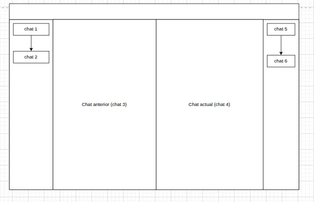

# ramas

Chat ramificado sobre [Claude Code](https://claude.com/claude-code): seleccionás
un fragmento de cualquier respuesta, abrís una **rama** que profundiza ese punto
en una conversación aparte, y cuando terminás la volvés a colapsar sin ensuciar
el hilo principal. Las ramas se muestran en pantalla dividida y se organizan en
un árbol navegable.



## Cómo funciona

- **Backend en Go**: habla con el CLI de Claude Code en local, mantiene el
  árbol de chats y guarda todo en SQLite.
- **Frontend en Vite/React**: la UI de chat, selección de texto y árbol de
  conversaciones.
- **Slash command `/estudiar`**: se corre desde una sesión de Claude Code en
  la terminal y levanta la web usando esa sesión como chat raíz.

Requiere tener [Claude Code](https://claude.com/claude-code) instalado y
logueado; "ramas" no habla con ningún modelo por su cuenta, delega todo en el
CLI local.

## Requisitos

- Go 1.21+
- Node.js 18+
- Claude Code CLI instalado (`claude`) y autenticado

## Instalación

Cloná el repo y buildeá las dos partes:

```bash
git clone https://github.com/lucho-sosa/ramas.git
cd ramas

# Frontend: genera backend/web con el build listo para servir
cd frontend
npm install
npm run build
cd ..

# Backend: compila el binario del servidor
cd backend
go build -o ramas-server .
cd ..
```

## Instalar el comando `/estudiar`

Esto deja "ramas" disponible como slash command dentro de cualquier sesión de
Claude Code.

```bash
mkdir -p ~/ramas ~/.claude/commands

# Binario + web buildeada + lanzador
cp backend/ramas-server ~/ramas/
cp -r backend/web ~/ramas/web
cp launch.sh ~/ramas/launch.sh
chmod +x ~/ramas/launch.sh

# El slash command
cp estudiar.md ~/.claude/commands/estudiar.md
```

## Uso

1. Abrí una sesión normal de Claude Code en la terminal, en cualquier
   proyecto.
2. Cuando quieras explorar un tema sin desviar la conversación principal,
   escribí `/estudiar`.
3. Se abre el navegador con esa sesión como chat raíz. Seleccioná un
   fragmento de cualquier respuesta, tocá "Abrir rama", y seguí esa idea en
   un chat aparte.
4. Cerrá la rama cuando termines (opcionalmente con "Resumir y mejorar",
   que agrega un mensaje resumen a la conversación principal). El chat
   padre vuelve a estar disponible para escribir.

### Notas

- Mientras una rama está abierta, su chat padre queda en modo solo lectura
  para evitar que la terminal y la web escriban a la vez sobre la misma
  sesión.
- Las ramas viven únicamente en la base SQLite de "ramas": no son sesiones
  reales de Claude Code y la terminal no se entera de ellas.
- Evitá mandarle un mensaje al chat raíz desde la web mientras esa misma
  sesión sigue activa en la terminal — puede generar turnos duplicados en
  el transcript.
- Después de tocar `backend/` o `frontend/` hay que repetir el build y
  volver a copiar `ramas-server` y `web/` a `~/ramas/` (no hay redeploy
  automático todavía).

## Desarrollo

```bash
# Backend (puerto 5173)
cd backend && go run . 

# Frontend con hot reload (puerto 5174, proxy hacia el backend)
cd frontend && npm run dev
```

Ver [`docs/DESIGN.md`](docs/DESIGN.md) para el detalle de arquitectura,
esquema de SQLite y las decisiones de diseño del proyecto.

## Estado

Prototipo funcional probado en local contra el CLI real de Claude Code.
Pendientes conocidos y limitaciones están documentados en
[`docs/DESIGN.md`](docs/DESIGN.md).
